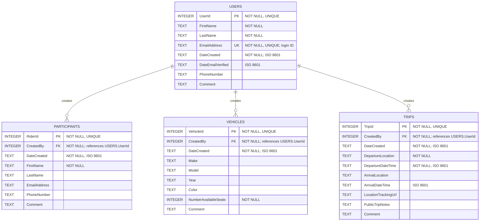

# CarpoolBuddy database schema prototype

This Mermaid ER diagram transcribes the four table prototypes from slides 1–4 of `CarpoolBuddyNotes.pptx`. Attribute names, declared types, and constraints follow the updated slides.

## Consistency review

- All three `CreatedBy` fields now use `INTEGER` and reference the `INTEGER` primary key `USERS.UserId`. The relationships therefore agree across the slides.
- The Trips primary key is now `TripId`, distinct from the Participants primary key `RiderId`.
- All four `DateCreated` fields specify `TEXT NOT NULL` and recommend the same ISO 8601 format.
- Trip departure and arrival are each represented as one ISO 8601 date-time field, avoiding separate date and time attributes. The example `2026-11-26T13:45:41-08:00` includes an explicit UTC offset.
- The slides declare dates and times as `TEXT`; the diagram preserves these prototype types. Consistent application-side validation is needed to ensure stored strings follow ISO 8601.
